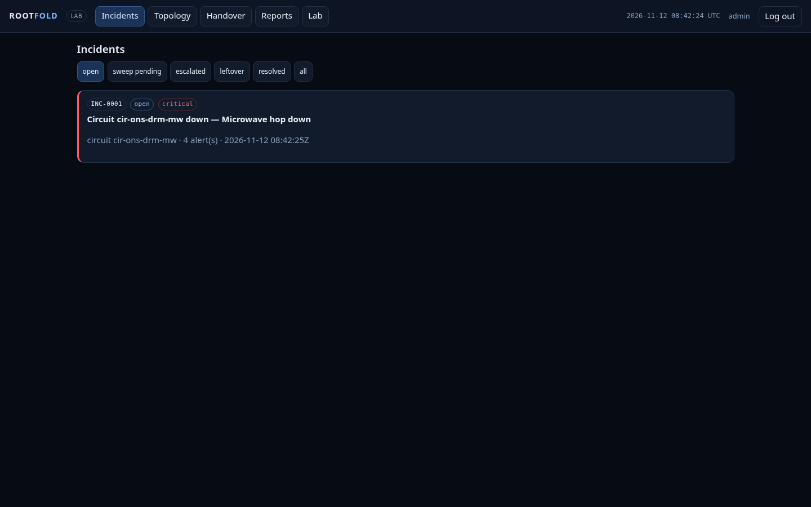
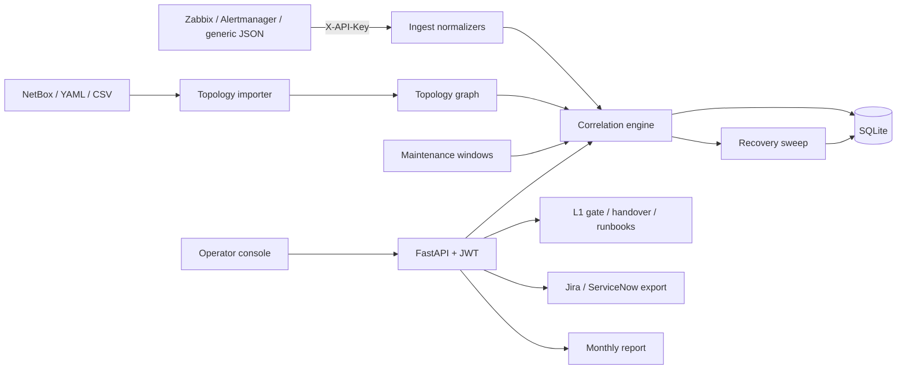
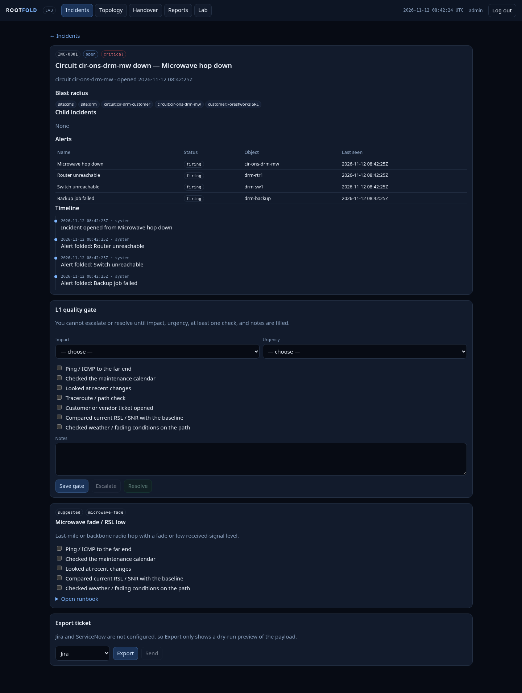
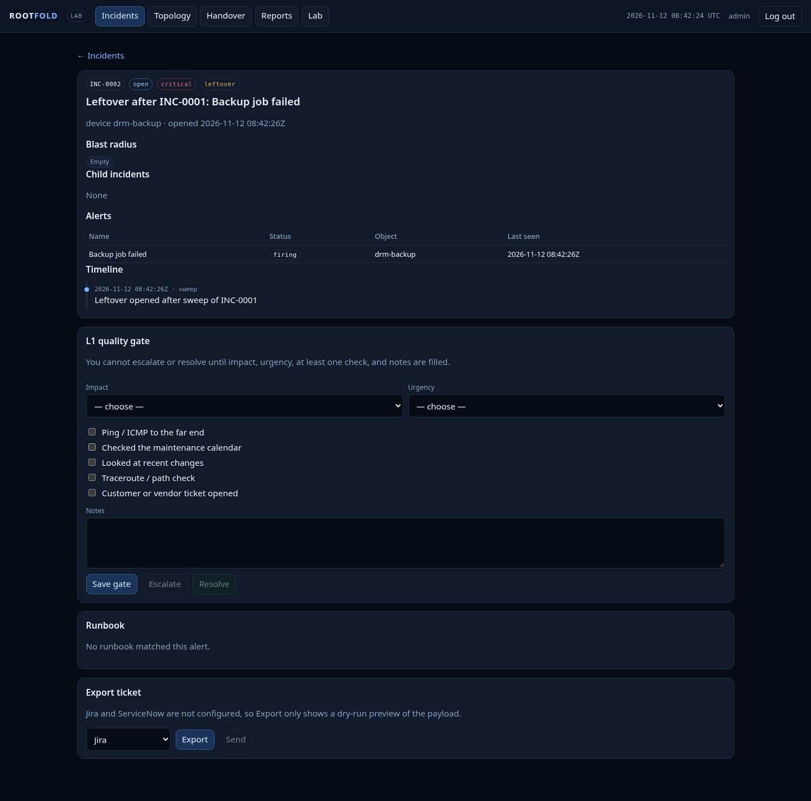
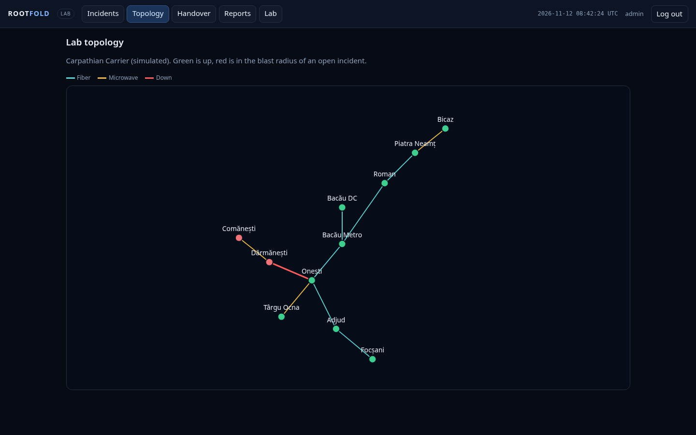

<div align="center">

<div style="font-size:64px">🧭</div>

# Rootfold

**One root-cause incident per outage — and no leftover failure closes silently.**

  <a href="LICENSE"></a>
  
  <a href="https://github.com/LucianCeusanRo/rootfold/stargazers"></a>
  <a href="https://github.com/LucianCeusanRo/rootfold/commits/main"></a>

[English](#-about) · [Română](#-română)

</div>

<p align="center"></p>

## 📑 Table of contents

- [📖 About](#-about)
- [✨ Features](#-features)
- [🧾 Honest disclaimer](#-honest-disclaimer)
- [🧠 How it works](#-how-it-works)
- [⚡ Quick start](#-quick-start)
- [📚 Step-by-step tutorial](#-step-by-step-tutorial)
- [🖼️ Screenshots](#-screenshots)
- [🔌 NetBox import](#-netbox-import)
- [🎓 Learning notes](#-learning-notes)
- [🔧 Configuration](#-configuration)
- [🗂️ Project structure](#-project-structure)
- [⚠️ Limitations](#-limitations)
- [❓ FAQ](#-faq)
- [🗺️ Roadmap](#-roadmap)
- [🤝 Contributing](#-contributing)
- [📄 License](#-license)
- [🇷🇴 Română](#-română)
- [👤 Author](#-author)

## 📖 About

A self-hosted incident layer for network operations teams.

Rootfold does **not** replace Zabbix, Prometheus, or Grafana. It sits in front of them: it folds a site or circuit outage into **one root-cause incident**, shows the **blast radius**, and after the parent recovers it **re-checks children** so a leftover failure cannot quietly close with the rest.

That last part is the point. In September 2026, operators on r/networking described a circuit flap that opened twenty tickets, then auto-closed them when the circuit returned — hiding a backup job that was still broken. Rootfold is built so that leftover cannot disappear.

The operator console is a thin, dark NOC UI served by the app itself: incident list and detail (timeline, children, blast radius, auto-attached runbooks, ticket export), a topology view of the lab, an L1 quality gate, shift handover with a required incoming ack, a monthly availability report, and buttons to inject or reset the simulated lab.

- **Used for:** when one fiber cut or microwave fade takes down a site, the NOC sees **one** incident with its blast radius (sites, devices, circuits, customers) instead of twenty alarms — and after recovery each child must report a fresh OK before it may close.
- **Helps:** small NOC / operations teams at ISPs, regional carriers, campuses or MSPs that already have monitoring (Zabbix, Prometheus Alertmanager) but no incident layer; also students who want to learn alert correlation, FastAPI and NOC workflows on a realistic simulated network.

## ✨ Features

- ✨ Topology import (YAML, a directory of CSVs, or a NetBox REST pull): sites, devices, microwave/fiber hops, LACP bundles, parent-child dependencies
- 🔎 Offline NetBox import from a recorded fixture (`rootfold import-netbox --fixture …` or `POST /api/topology/import-netbox`)
- ⚙️ Webhook ingest: Alertmanager, Zabbix, generic JSON
- 📊 Correlation: child alerts fold under one root-cause incident; blast radius
- 🛡️ Recovery sweep: on parent clear, wait N seconds (default 300; configurable), require a **fresh** OK from each child; leftovers become their own incident
- 🧩 Background sweep scheduler (configurable interval; `POST /api/ops/sweep` still works)
- 🌐 Maintenance-window suppression (object or ancestor)
- 🧪 L1 quality gate: impact, urgency, at least one check, and notes are required before an operator can escalate or resolve (API + UI). Sweep auto-resolve skips the gate.
- 📦 Shift handover: snapshot of open incidents, required ack from the incoming shift (API + UI)
- 🚀 Operator console: vanilla JS, no build step, dark mobile-friendly NOC UI, served at `/`
- 🗂️ JWT for operators, API keys for webhooks, structured JSON logs
- 🔔 `/healthz`, Caddy reverse proxy with security headers and local TLS
- 💾 Ticket export to Jira Cloud (REST v3) and ServiceNow (incident table), with dry-run payload preview when not configured
- 📈 Markdown runbook library auto-attached by alert type; checklist ticks feed the L1 gate
- ✨ Monthly availability report per circuit, site, and customer: uptime %, MTTR, incident count, SLA breach flag; JSON, CSV, and print-to-PDF
- 🔎 pytest suite (including the Sept 2026 leftover-child scenario) and Playwright UI smokes
- ⚙️ GitHub Actions CI workflow (lint + tests)

## 🧾 Honest disclaimer

The bundled inventory (**Carpathian Carrier**) is a **simulated regional-carrier lab**, not a production network and not anyone’s workplace. A public/demo instance, when it exists, will use the same lab feed. Self-host if you want to ingest real Alertmanager or Zabbix webhooks against a topology **you** import.

There is no hosted demo yet; run it locally with the steps below.

## 🧠 How it works



An alert is normalized, matched to a topology object and folded under the highest firing root. When the root clears, the sweep waits (default 300 s) and needs a **fresh** OK from every child; children still failing become their own incident. Full data flow: [`docs/architecture.md`](docs/architecture.md).

**Tech stack:** Python 3.11+, FastAPI, SQLAlchemy + SQLite, PyJWT, pytest, Playwright, Docker Compose, Caddy, vanilla JavaScript.

## ⚡ Quick start

```bash
git clone https://github.com/LucianCeusanRo/rootfold.git && cd rootfold
uv sync --extra dev        # or: python -m venv .venv && pip install -e ".[dev]"
cp .env.example .env       # lab defaults only
make run                   # http://127.0.0.1:8000  (login admin / changeme)
```

## 📚 Step-by-step tutorial

### 1. Install, configure, run (local, no Docker)

```bash
# Python 3.11+
uv sync --extra dev          # or: python -m venv .venv && pip install -e ".[dev]"
cp .env.example .env         # lab defaults only
uv run playwright install chromium   # once, for UI smoke tests
make test
make run                     # http://127.0.0.1:8000  (console) and  /api/docs
```

Default lab credentials (change before any real use):

- Day operator: `admin` / `changeme`
- Night operator (handover demos): `night` / `changeme`
- Webhook API key header: `X-API-Key: lab-webhook-key`

### 2. Typical walkthrough

Open the console at `/` and sign in. The example topology is imported automatically on first login. From **Lab**, inject *Microwave fade*, *Fiber LOS*, *LACP member down*, or *Parent recovers, leftover child remains*. The matching runbook attaches automatically; **Export** on the incident page previews a Jira or ServiceNow payload (dry-run unless those backends are configured). **Reports** shows monthly uptime, MTTR, and SLA flags, with CSV and print-to-PDF. Reset clears incidents and reloads the inventory.

You can still drive the same flows from the API:

```bash
TOKEN=$(curl -s http://127.0.0.1:8000/api/auth/login \
  -H 'Content-Type: application/json' \
  -d '{"username":"admin","password":"changeme"}' | python3 -c 'import sys,json; print(json.load(sys.stdin)["access_token"])')

curl -s -X POST http://127.0.0.1:8000/api/lab/inject/leftover_sweep \
  -H "Authorization: Bearer $TOKEN"
```

### API

OpenAPI / Swagger lives at `/api/docs` (JWT for operators, API keys for `/api/ingest/*`).

### 3. Docker Compose + Caddy TLS

```bash
docker compose up --build
# API via Caddy: https://localhost:8443  (TLS from Caddy's internal CA — lab only)
# HTTP :8080 redirects to https://localhost:8443
```

Caddy stores its internal CA in the `caddy-data` volume (`/data/caddy/pki/authorities/local/root.crt` in the container). Trust it only on lab machines.

## 🖼️ Screenshots







| View | Desktop | Mobile |
| --- | --- | --- |
| Login | [docs/screenshots/ui-login-desktop.png](docs/screenshots/ui-login-desktop.png) | [docs/screenshots/ui-login-mobile.png](docs/screenshots/ui-login-mobile.png) |
| Incidents | [docs/screenshots/ui-incidents-desktop.png](docs/screenshots/ui-incidents-desktop.png) | [docs/screenshots/ui-incidents-mobile.png](docs/screenshots/ui-incidents-mobile.png) |
| Incident detail | [docs/screenshots/ui-incident-detail-desktop.png](docs/screenshots/ui-incident-detail-desktop.png) | [docs/screenshots/ui-incident-detail-mobile.png](docs/screenshots/ui-incident-detail-mobile.png) |
| Leftover child | [docs/screenshots/ui-leftover-desktop.png](docs/screenshots/ui-leftover-desktop.png) | [docs/screenshots/ui-leftover-mobile.png](docs/screenshots/ui-leftover-mobile.png) |
| Topology | [docs/screenshots/ui-topology-desktop.png](docs/screenshots/ui-topology-desktop.png) | [docs/screenshots/ui-topology-mobile.png](docs/screenshots/ui-topology-mobile.png) |
| Lab controls | [docs/screenshots/ui-lab-desktop.png](docs/screenshots/ui-lab-desktop.png) | [docs/screenshots/ui-lab-mobile.png](docs/screenshots/ui-lab-mobile.png) |
| Shift handover | [docs/screenshots/ui-handover-desktop.png](docs/screenshots/ui-handover-desktop.png) | [docs/screenshots/ui-handover-mobile.png](docs/screenshots/ui-handover-mobile.png) |
| Ticket export (dry-run) | [docs/screenshots/ui-export-desktop.png](docs/screenshots/ui-export-desktop.png) | [docs/screenshots/ui-export-mobile.png](docs/screenshots/ui-export-mobile.png) |
| Monthly report | [docs/screenshots/ui-reports-desktop.png](docs/screenshots/ui-reports-desktop.png) | [docs/screenshots/ui-reports-mobile.png](docs/screenshots/ui-reports-mobile.png) |
| OpenAPI | [docs/screenshots/swagger.png](docs/screenshots/swagger.png) | — |

Regenerate the UI captures with `make test-ui` (writes into `docs/screenshots/`).

## 🔌 NetBox import

```bash
# Recorded fixture — no live NetBox required
uv run rootfold import-netbox --fixture tests/fixtures/netbox.json

# Live NetBox (token from the environment or flags)
# ROOTFOLD_NETBOX_URL=https://netbox.example ROOTFOLD_NETBOX_TOKEN=… \
#   uv run rootfold import-netbox
```

Same mapping is available as `POST /api/topology/import-netbox`. Same-site patch cables are skipped; provider circuits and inter-site cables become Rootfold hops.

Ticket backends (`ROOTFOLD_JIRA_*`, `ROOTFOLD_SNOW_*`) and the SLA threshold (`ROOTFOLD_SLA_PERCENT`, default 99.9) are documented in `.env.example`. Leave them empty for dry-run export previews.

## 🎓 Learning notes

If you are new to this stack, start with [`docs/LEARN.md`](docs/LEARN.md) (Romanian, beginner-friendly, with interview questions) and [`docs/architecture.md`](docs/architecture.md).

---

## 🔧 Configuration

All settings are environment variables with the `ROOTFOLD_` prefix; the full list with lab defaults is in [`.env.example`](.env.example). The most important ones:

| Variable | Required | What it does |
|---|---|---|
| `ROOTFOLD_ADMIN_USERNAME / _PASSWORD` | yes (change!) | day-operator login (lab default admin / changeme) |
| `ROOTFOLD_JWT_SECRET` | yes | signs operator tokens — set a long random value |
| `ROOTFOLD_WEBHOOK_KEY` | yes | value expected in the `X-API-Key` header of webhooks |
| `ROOTFOLD_DATABASE_URL` | no | database URL (default SQLite in `./data/`) |
| `ROOTFOLD_RECOVERY_SWEEP_SECONDS` | no | wait after the parent clears before re-checking children (default 300) |
| `ROOTFOLD_NETBOX_URL / _TOKEN` | no | live NetBox import |
| `ROOTFOLD_JIRA_* / ROOTFOLD_SNOW_*` | no | real ticket export (empty = dry-run preview) |
| `ROOTFOLD_SLA_PERCENT` | no | SLA threshold for the monthly report (default 99.9) |

## 🗂️ Project structure

```
src/rootfold/
  main.py, api/          FastAPI app and routers
  ingest.py, engine.py, graph.py      webhook normalizers, correlation + sweep, topology graph
  importer.py, netbox.py              YAML/CSV/NetBox topology import
  gate.py, handover.py, runbooks.py, runbooks/   L1 gate, shift handover, Markdown runbooks
  exporters.py, reports.py            Jira/ServiceNow export, availability report
  scheduler.py, lab.py, auth.py, db.py, models.py, config.py
  static/                operator console (HTML/CSS/JS)
examples/                Carpathian Carrier lab topology
tests/                   pytest + Playwright UI tests, NetBox fixture
deploy/, Dockerfile, docker-compose.yml   Caddy + container setup
docs/                    architecture.md, LEARN.md, screenshots/
```

## ⚠️ Limitations

- Early-stage project: tested only against the bundled simulated lab and recorded fixtures, not in a production NOC.
- SQLite by default; a single instance runs the background sweep (no clustering / HA).
- Users and roles are minimal (operators configured in `.env`); no SSO/LDAP.
- Jira and ServiceNow export is one-way and was verified as dry-run payloads only.
- Correlation relies on a correct topology: missing dependencies mean alerts are not folded.

## ❓ FAQ

<details><summary><b>Does it replace Zabbix or Prometheus?</b></summary>

No. They keep monitoring; Rootfold receives their webhooks and manages the incident.

</details>

<details><summary><b>Is the Carpathian Carrier network real?</b></summary>

No, it is a simulated lab bundled for demos and tests.

</details>

<details><summary><b>Can I try it without Jira or ServiceNow?</b></summary>

Yes — export shows a dry-run payload preview when those backends are not configured.

</details>

<details><summary><b>How do I reproduce the "leftover child" case?</b></summary>

Open **Lab** and inject *Parent recovers, leftover child remains*, or run `pytest -k leftover`.

</details>

## 🗺️ Roadmap

- [ ] Postgres deployment guide
- [ ] SSO / OIDC login for operators
- [ ] Two-way ticket sync
- [ ] Public demo instance on the lab feed

## 🤝 Contributing

Issues and pull requests are welcome. Run `make test` (pytest + Playwright smokes) before opening a PR, keep the lab data simulated, and never commit real credentials.

## 📄 License

MIT — see [LICENSE](LICENSE).

## 🇷🇴 Română

<details>
<summary><b>Click pentru versiunea în limba română</b></summary>

**Rootfold** este un strat de incidente, self-hosted, pentru echipele de operațiuni de rețea (NOC).

Nu înlocuiește Zabbix, Prometheus sau Grafana, ci stă în fața lor: strânge căderea unui site sau a unui circuit într-un **singur incident cu cauza principală**, arată **zona afectată (blast radius)**, iar după ce părintele își revine **re-verifică fiecare copil**, ca o defecțiune rămasă să nu se închidă pe tăcute odată cu restul.

**Atenție:** inventarul inclus (**Carpathian Carrier**) este un **laborator simulat** de operator regional, nu o rețea reală și nu locul de muncă al cuiva.

#### La ce folosește și pe cine ajută
- **Folosește la:** când o fibră tăiată sau un fading pe microunde pică un site, NOC-ul vede **un singur** incident cu zona afectată, nu douăzeci de alarme; după revenire, fiecare copil trebuie să raporteze un OK proaspăt înainte să se închidă.
- **Ajută:** echipe NOC mici (ISP, operatori regionali, campusuri, MSP) care au deja monitorizare dar nu au un strat de incidente; și studenții care vor să învețe corelarea alertelor pe o rețea simulată realistă.

#### Arhitectură
Webhook-uri (Zabbix / Alertmanager / JSON) → normalizare → potrivire pe topologie → motor de corelare (incident rădăcină, blast radius) → recovery sweep → SQLite; peste ele API FastAPI, poarta L1, handover, runbook-uri, export tichete, raport lunar și consola de operator. Detalii în [`docs/architecture.md`](docs/architecture.md).

#### Funcționalități
- Import de topologie din YAML, CSV sau NetBox (live ori dintr-un fixture înregistrat): site-uri, echipamente, hop-uri microunde/fibră, bundle-uri LACP, dependențe părinte–copil
- Primire alerte prin webhook: Alertmanager, Zabbix, JSON generic
- Corelare: alertele copil se strâng sub un singur incident cu cauza principală; blast radius
- Recovery sweep: după revenirea părintelui așteaptă N secunde și cere un OK **proaspăt** de la fiecare copil; ce rămâne căzut devine incident separat
- Suprimare în ferestre de mentenanță
- Poartă de calitate L1: impact, urgență, cel puțin o verificare și note, obligatorii înainte de escaladare/rezolvare
- Predare de tură (handover) cu confirmare obligatorie de la tura care intră
- Consolă de operator (JS simplu, fără build, temă întunecată, merge pe mobil)
- Export de tichete către Jira Cloud și ServiceNow, cu previzualizare dry-run
- Runbook-uri Markdown atașate automat după tipul alertei
- Raport lunar de disponibilitate: uptime %, MTTR, număr de incidente, depășire SLA (JSON, CSV, print-to-PDF)
- JWT pentru operatori, chei API pentru webhook-uri, loguri JSON, `/healthz`, Caddy cu TLS local
- Teste pytest și teste UI cu Playwright, CI cu GitHub Actions

#### Tehnologii
Python 3.11+, FastAPI, SQLAlchemy + SQLite, PyJWT, pytest, Playwright, Docker Compose, Caddy, JavaScript simplu.

#### Tutorial
```bash
uv sync --extra dev          # sau: python -m venv .venv && pip install -e ".[dev]"
cp .env.example .env         # doar valori de laborator
make test
make run                     # http://127.0.0.1:8000 (consolă) și /api/docs
```
Sau cu Docker: `docker compose up --build`, apoi https://localhost:8443.

Conturile implicite de laborator (`admin` / `changeme`) sunt doar pentru test; schimbă-le în `.env` înainte de orice folosire reală.

**Utilizare tipică:** intri în consolă la `/`, topologia de exemplu se importă automat; din **Lab** injectezi *Microwave fade*, *Fiber LOS*, *LACP member down* sau *Parent recovers, leftover child remains*; deschizi incidentul (timeline, copii, blast radius, runbook atașat), completezi poarta L1, previzualizezi exportul Jira/ServiceNow, apoi vezi **Reports** pentru uptime, MTTR și SLA. **Reset** golește laboratorul.

#### Structura proiectului
`src/rootfold/` (API, motor, import, poarta L1, handover, export, rapoarte, consolă în `static/`), `examples/` (laboratorul), `tests/`, `deploy/` (Caddy), `docs/`.

#### Limitări
- Proiect la început: testat doar pe laboratorul simulat și pe fixture-uri, nu într-un NOC real.
- SQLite implicit, o singură instanță (fără HA).
- Utilizatori minimi, fără SSO/LDAP.
- Exportul Jira/ServiceNow e într-o singură direcție, verificat doar ca dry-run.
- Corelarea depinde de o topologie corectă.

#### Capturi de ecran
Vezi tabelul din secțiunea în engleză; toate imaginile sunt în [`docs/screenshots/`](docs/screenshots/).

#### Note de învățare
[`docs/LEARN.md`](docs/LEARN.md) (în română, pentru începători, cu întrebări de interviu) și [`docs/architecture.md`](docs/architecture.md).

</details>

## 👤 Author

**Lucian-Ciprian Ceușan** — telecom & network technician, Bucharest, Romania

[](https://lucian-ceusan.vercel.app) [](https://www.linkedin.com/in/lucian-ceusan-7a9179210) [](https://github.com/LucianCeusanRo)
