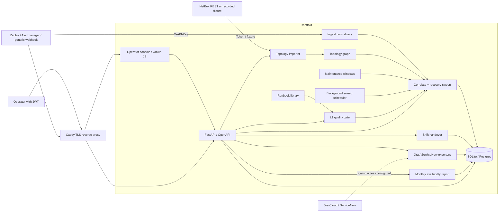

# Rootfold architecture

Data flow:

1. A webhook arrives at `/api/ingest/{alertmanager,zabbix,generic}` with an API key (or a lab operator uses `POST /api/lab/inject/{scenario}`). Topology can also be pulled from NetBox (`POST /api/topology/import-netbox` or `rootfold import-netbox`) and upserted by slug. A recorded fixture stands in when no live NetBox is available.
2. The payload is normalized (fingerprint, severity, labels). Labels are matched to a topology object (circuit, device, site, bundle).
3. If the object — or an ancestor — is in an active maintenance window, the alert is stored as **suppressed** and does not open an incident.
4. Otherwise the engine walks parent-child dependencies (plus implicit site→device and bundle→member edges) and folds the alert under the highest currently firing root. Blast radius is the descendant set (sites, devices, circuits, customers).
5. When the **root** alert clears, the incident goes to `sweep_pending` until `now + recovery_sweep_seconds`. Child “resolved” events that arrive at recovery time are treated as **stale** and do not count as a fresh OK.
6. After the wait, the background scheduler (or `POST /api/ops/sweep`) closes the parent and opens a `kind=leftover` incident for every child that is still firing or has no OK dated at or after `sweep_after`. Sweep auto-resolve does not require the L1 gate.
7. Matching runbooks from `docs/runbooks/` attach automatically (alert name, keywords, circuit media). Ticking a runbook check writes into `incident.checks` and feeds the L1 gate; it does not by itself complete the gate.
8. An operator may escalate or resolve only after `PUT /api/incidents/{id}/gate` has impact, urgency, at least one check, and notes (API returns 422 otherwise; the console disables the buttons).
9. `POST /api/incidents/{id}/export` builds a Jira Cloud REST v3 or ServiceNow incident-table payload. Without credentials the default is **dry-run** (the payload is stored and shown; nothing is sent). Sending with no backend configured returns 422.
10. `GET /api/reports/availability?year=&month=` computes, per circuit, site, and customer, the union of overlapping incident intervals in that UTC calendar month: uptime %, MTTR of resolved incidents, incident count, and an SLA-breach flag against `ROOTFOLD_SLA_PERCENT` (default 99.9). `format=csv` and the console print stylesheet cover export.
11. `POST /api/handover/close` snapshots open / sweep_pending / escalated incidents. A second close is blocked until the incoming shift `POST /api/handover/{id}/ack`.

The operator console is static files under `src/rootfold/static/`, served at `/` and `/static`, talking to the same JWT API. There is no separate frontend build. Routes include `#/incidents`, `#/incidents/:id`, `#/topology`, `#/handover`, `#/lab`, and `#/reports`.

Persistence is SQLAlchemy. The default URL is SQLite; set `ROOTFOLD_DATABASE_URL` to a Postgres URL when you are ready (`postgresql+psycopg://...`). No SQLite-only types are used.
